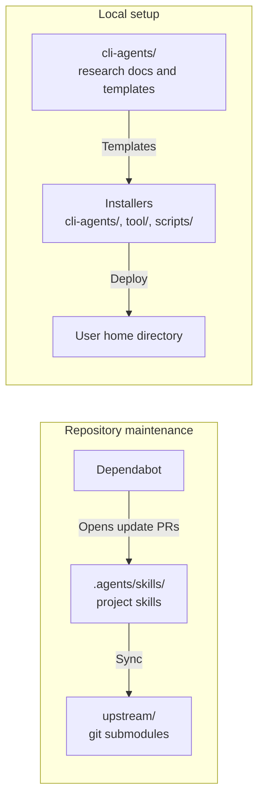

# ai-research

- AI 工具研究與 Skills 知識庫：彙整 Claude Code、GitHub Copilot CLI、Codex 等 AI 工具的使用方式，並以 git submodule 追蹤上游 skill、plugin 與 MCP server。

## Table of Contents

- [開始使用](#開始使用)
- [專案概覽](#專案概覽)

---

## 開始使用

- 取得專案後，使用 Git 初始化上游 submodule：

```powershell
git submodule update --init --recursive
```

- 要一次安裝 Claude Code CLI、Codex CLI、共用系統提示詞等本機工具，執行 [scripts/install-all.ps1 / .sh](scripts/SCRIPTS.md#install-all)；各安裝腳本的前置條件、行為與風險看 [一鍵安裝腳本](cli-agents/CLI-AGENTS.md#一鍵安裝腳本)。
- 要讓 Claude Code 讀取專案 skills，使用 [Link Agent Skills](scripts/SCRIPTS.md#link-agent-skills) 建立本機連結；Windows 執行 [link-agent-skills.ps1](scripts/link-agent-skills.ps1)，macOS / Linux 執行 [link-agent-skills.sh](scripts/link-agent-skills.sh)，選擇 `1`。

[Back to top](#table-of-contents)

---

## 專案概覽

- 本 repo 是研究筆記、設定範本與維護流程的集合，不對外發佈成 plugin。
- 上游專案以 git submodule 放在 [upstream](upstream/UPSTREAM.md)，由 Dependabot 偵測更新、專案 skills 處理同步；嚴禁直接修改上游內容。
- 主要目錄：

| 目錄 | 說明 |
|------|------|
| [upstream](upstream/UPSTREAM.md) | 上游 submodule 清單、同步流程與安裝方式 |
| [cli-agents](cli-agents/CLI-AGENTS.md) | AI CLI 參考文件、使用者級別設定範本與一鍵安裝腳本 |
| [scripts](scripts/SCRIPTS.md) | repo 維護腳本與安裝選單 |
| [tool](tool/TOOL.md) | 本機工具文件、PowerShell profile 與 AI CLI 捷徑 |
| [ide](ide/goland.md) | IDE 設定筆記 |

- AI agent 的工作規則看 [LORE_ch.md](LORE_ch.md)（英文版 [LORE.md](LORE.md)）。
- 文件結構：
    - [LORE.md](LORE.md)：所有 AI agent 共用的規則與閱讀入口。
    - [AGENTS.md](AGENTS.md)：agent 通用入口，只負責轉介到 LORE；Codex 另外讀 CODEX。
    - [CLAUDE.md](CLAUDE.md)：Claude Code 入口，匯入 LORE 並放 Claude 專屬規則。
    - [CODEX.md](CODEX.md)：Codex 專屬規則。
    - `*_ch.md`：同名英文檔的等價繁體中文版本。
    - [.agents/skills](.agents/skills)：專案 skill 的唯一位置；`.claude/skills` 是指向它的本機 link。
- 專案 skills 只放本 repo 的治理規則、同步流程與共用協議；使用時機看 [LORE 閱讀指引](LORE_ch.md#閱讀指引)。



[Back to top](#table-of-contents)
