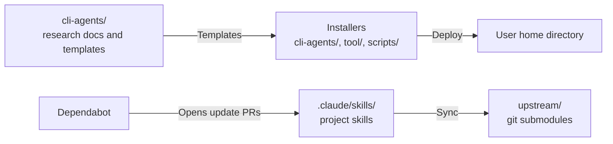

# ai-research

AI 工具研究與 Skills 知識庫：彙整 Claude Code、GitHub Copilot CLI、Codex 等 AI 工具的使用方式，並以 submodule 追蹤上游 skill、plugin 與 MCP server。

## Table of Contents

- [開始使用](#開始使用)
- [專案概覽](#專案概覽)
- [目錄](#目錄)
- [Project Skills](#project-skills)

---

## 開始使用

```powershell
# 連同所有 submodule 一起 clone 後，或已 clone 但沒加 --recursive 時
git submodule update --init --recursive
```

- 要一次安裝 Claude Code CLI、Codex CLI、共用系統提示詞等本機工具，執行 [scripts/install-all.ps1 / .sh](scripts/SCRIPTS.md#install-all)；各安裝腳本的內容與風險看 [一鍵安裝腳本](cli-agents/CLI-AGENTS.md#一鍵安裝腳本)。

[Back to top](#table-of-contents)

---

## 專案概覽

- 本 repo 本身不是可安裝的 plugin，而是研究筆記、設定範本與維護流程的集合。
- 上游專案以 git submodule 放在 [upstream](upstream/UPSTREAM.md)，由 Dependabot 偵測更新、`sync-all` 同步；本 repo 不直接修改上游內容。
- 給 AI agent 的工作規則看 [AGENTS_ch.md](AGENTS_ch.md)。



[Back to top](#table-of-contents)

---

## 目錄

| 目錄                                   | 說明                                                                                   |
|----------------------------------------|----------------------------------------------------------------------------------------|
| [upstream](upstream/UPSTREAM.md)       | 上游 submodule（skill、plugin、MCP server）的清單、同步流程與各自的安裝方式            |
| [cli-agents](cli-agents/CLI-AGENTS.md) | 各 AI CLI 的參考文件、使用者級別設定範本、一鍵安裝腳本，以及 Agent 與 Skill 差異的研究結論 |
| [scripts](scripts/SCRIPTS.md)          | repo 維護與自動化腳本，以及 `install-all` 安裝選單                                     |
| [tool](tool/TOOL.md)                   | 本機工具文件，例如 PowerShell profile 與 AI CLI 捷徑                                   |
| [ide](ide/goland.md)                   | IDE 設定筆記                                                                           |
| [.claude/skills](.claude/skills)       | 本 repo 維護用的 project skills                                                        |

[Back to top](#table-of-contents)

---

## Project Skills

- 本 repo 的 project skills 只放治理規則與 repo 專用 workflow，讓 AI 工具在維護本 repo 時即時載入，不對外發佈成 plugin。

| Skill                                                           | 用途                                                       |
|-----------------------------------------------------------------|------------------------------------------------------------|
| [sync-all](.claude/skills/sync-all/SKILL.md)                    | 依 Dependabot 開出的 submodule PR，呼叫對應的 sync skill   |
| [anthropic-skills-sync](.claude/skills/anthropic-skills-sync/SKILL.md) | 同步 `anthropic-skills` 上游並摘要變更              |
| [cli-doc-sync](.claude/skills/cli-doc-sync/SKILL.md)            | 將 `cli-agents/` 的 CLI 參考文件與官方文件對齊             |
| [skills-governance](.claude/skills/skills-governance/SKILL.md)  | 建立或修改 project skill 時的目錄邊界、文件同步與 commit 規則 |

[Back to top](#table-of-contents)
