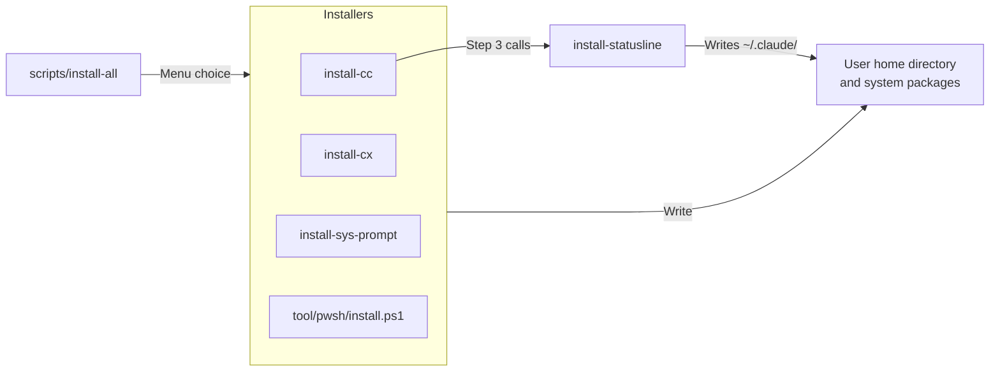

# cli-agents

- 本目錄整理各 AI CLI agent 的參考文件、使用者級別設定範本，以及寫入使用者家目錄的一鍵安裝腳本。

## Table of Contents

- [文件索引](#文件索引)
- [一鍵安裝腳本](#一鍵安裝腳本)
    - [共用 Prompt 安裝器行為](#共用-prompt-安裝器行為)
- [Agent 與 Skill 差異](#agent-與-skill-差異)
    - [核心區分](#核心區分)
    - [兩者如何搭配](#兩者如何搭配)
    - [Claude Code 與 GitHub Copilot 的差異](#claude-code-與-github-copilot-的差異)
    - [Marketplace / Plugin 能不能放 Agent](#marketplace--plugin-能不能放-agent)
    - [這個 repo 目前怎麼看](#這個-repo-目前怎麼看)

---

## 文件索引

| 文件                                                                                | 說明                                                                                                         |
|-------------------------------------------------------------------------------------|--------------------------------------------------------------------------------------------------------------|
| [prompt-user.md](prompt-user.md) / [prompt-user_ch.md](prompt-user_ch.md) | 可追加到 Claude Code、Codex 等 AI 工具設定檔的共用基本守則，包含語言偏好、工作態度與禁止行為                 |
| [prompt-custom.md](prompt-custom.md) / [prompt-custom_ch.md](prompt-custom_ch.md) | 環境注意事項，可依工作環境調整；區分工作環境案例與專案經驗的紀錄位置 |
| [hooks-cross-tool.md](hooks-cross-tool.md)                                          | 比較 Claude Code、GitHub Copilot CLI、Codex CLI 的 hook 核心差異，並整理共用 plugin skill + hook 的封裝策略  |
| [claude-code/cc-cli.md](claude-code/cc-cli.md)                                      | Claude Code：CLI 參數、slash commands、快捷鍵，以及 built-in / custom agent 用法                             |
| [github-copilot/gc-cli.md](github-copilot/gc-cli.md)                                | GitHub Copilot CLI：CLI 參數、slash commands、custom instructions，以及 built-in / custom agent 用法         |
| [codex/cx-cli.md](codex/cx-cli.md)                                                  | Codex CLI：安裝、登入、approval / sandbox、`codex exec`、subagents、`AGENTS.md`、slash commands、config，以及 TUI 快捷操作 |

- 各工具目錄下的 `.claude/`、`.codex/`、`.copilot/` 是使用者級別設定範本，複製到家目錄對應位置才會生效。

[Back to top](#table-of-contents)

---

## 一鍵安裝腳本



- 這些腳本會寫入**使用者家目錄**（repo 之外），因此不收錄在 [scripts/SCRIPTS.md](../scripts/SCRIPTS.md)。
- [scripts/install-all.ps1 / .sh](../scripts/SCRIPTS.md#install-all) 提供互動選單，可一次選擇要執行的安裝項目；桌面應用程式熱鍵腳本（`setup-cc-desktop-ahk.ps1`、`setup-cx-desktop-ahk.ps1`）放在 `scripts/` 下，收錄在 [scripts/SCRIPTS.md](../scripts/SCRIPTS.md)。
- Windows 的 `install-cc.ps1` 使用 Claude 官方原生安裝器；`install-cx.ps1` 使用 npm 安裝 Codex。兩者僅在缺少所需 Node.js/npm 時用 winget 安裝 Node.js LTS，已有可執行的相依套件則沿用，不自動更新；不完整的 Node.js/npm 安裝會停止並要求修復。macOS 的 `.sh` 仍使用 Homebrew 處理 Node.js、npm 安裝 CLI。這些腳本會安裝軟體並寫入使用者家目錄，副作用見下表。

| 腳本                                                                  | 安裝目標                                                                                  | 內容                                                                                                                                                                                                                                                                                                                                                                                   | 範例                                                                                     |
|-----------------------------------------------------------------------|-------------------------------------------------------------------------------------------|----------------------------------------------------------------------------------------------------------------------------------------------------------------------------------------------------------------------------------------------------------------------------------------------------------------------------------------------------------------------------------------|------------------------------------------------------------------------------------------|
| [claude-code/install-cc.ps1](claude-code/install-cc.ps1) | Node.js（缺少時）+ `~/.local/bin/claude.exe` + `~/.claude/` | 三步驟：1) 先檢查 Git for Windows 的 Git Bash 與 status line 來源，再確認 Node.js、Git Bash 中的 `node --version` 及 status line 所需的 `?.`／`??` 語法能力；2) 下載 `https://claude.ai/install.ps1`，在獨立 PowerShell 程序執行；原生版通過 `--version` 後，先將原生目錄加入使用者 PATH（原已存在時略過），再移除目前 npm prefix 的舊 Claude 套件，並確認 `claude` 指令解析至原生安裝目錄；3) 呼叫 [install-statusline.ps1](claude-code/install-statusline.ps1) 部署 status line 與 hooks。 | `powershell -ExecutionPolicy Bypass -File .\cli-agents\claude-code\install-cc.ps1` |
| [claude-code/install-cc.sh](claude-code/install-cc.sh)                | 系統層級（Node.js/npm/jq）+ `~/.claude/`                                                  | macOS 腳本仍以 npm 安裝 Claude CLI；用 Homebrew 處理相依套件：缺 npm 時 `brew install node`；已有 npm 且是 Homebrew 裝的（`brew list node` 找得到）才 `brew upgrade node`，否則略過更新；第三步前先確保 `jq` 存在（缺的話用 `brew install jq` 補上），再呼叫 [install-statusline.sh](claude-code/install-statusline.sh)                                                                                | `bash ./cli-agents/claude-code/install-cc.sh`                                            |
| [claude-code/install-statusline.ps1](claude-code/install-statusline.ps1) | `~/.claude/`                                                                           | 複製 [statusline-command.sh](claude-code/statusline-command.sh) 與 [hooks/*.sh](claude-code/hooks/)；在 `~/.claude/settings.json` 注入 `statusLine`，以及 `UserPromptSubmit` / `PreToolUse` / `Stop` 三個即時狀態追蹤 hooks                                                                                                                                                         | `powershell -ExecutionPolicy Bypass -File .\cli-agents\claude-code\install-statusline.ps1` |
| [claude-code/install-statusline.sh](claude-code/install-statusline.sh) | `~/.claude/`                                                                             | `install-statusline.ps1` 的 macOS/Linux 版本，邏輯相同；用 `jq` 安全改寫 `settings.json`（需先自行安裝，例如 `brew install jq`），未安裝時會直接報錯並提示                                                                                                                                                                                                                          | `bash ./cli-agents/claude-code/install-statusline.sh`                                    |
| [codex/install-cx.ps1](codex/install-cx.ps1) | Node.js/npm（缺少時）+ npm 全域套件 + `~/.codex/pets/` | 三步驟：1) 先檢查 pets 來源，再確認 Node.js/npm 可執行；2) `npm install -g --engine-strict --include=optional @openai/codex`，安裝失敗即停止；驗證 npm prefix 中的 `codex.cmd --version`，必要時將 prefix 加入使用者 PATH，並確認 `codex` 指令來源；3) 遞迴複製 [pets/](codex/pets/)，覆蓋同名檔案，不刪除目的地多出的檔案。 | `powershell -ExecutionPolicy Bypass -File .\cli-agents\codex\install-cx.ps1` |
| [codex/install-cx.sh](codex/install-cx.sh)                            | 系統層級（Node.js/npm）+ `~/.codex/pets/`                                                 | macOS 版對應腳本，同樣三步驟，改用 Homebrew 處理 npm（邏輯與 `install-cc.sh` 相同），第三步用 `cp -Rf` 把 [pets/](codex/pets/) 複製到 `~/.codex/pets/`                                                                                                                                                                                                                              | `bash ./cli-agents/codex/install-cx.sh`                                                  |
| [install-sys-prompt.ps1](install-sys-prompt.ps1)                      | `$env:USERPROFILE\.claude\`、`$env:USERPROFILE\.codex\`、`$env:USERPROFILE\.copilot\`     | 若目標檔已存在，先改名備份為 `<檔名>_yyMMddHHmmss`，再複製三個工具的提示範本；然後依序將 [prompt-user.md](prompt-user.md) 與英文 custom（預設 [prompt-custom.md](prompt-custom.md)，可用參數替換）append 到 `CLAUDE.md`、`AGENTS.md` 與 `copilot-instructions.md` 底部                                                                                                                                                                                       | `powershell -ExecutionPolicy Bypass -File .\cli-agents\install-sys-prompt.ps1 [-CustomPromptPath <file>]`           |
| [install-sys-prompt.sh](install-sys-prompt.sh)                        | `$HOME/.claude/`、`$HOME/.codex/`、`$HOME/.copilot/`                                      | 與 PowerShell 版本相同，適用於 macOS、Linux 的 Bash 與 Windows 的 Git Bash；先部署範本，再依序將 [prompt-user.md](prompt-user.md) 與英文 custom（預設 [prompt-custom.md](prompt-custom.md)，可用參數替換）append 到 `CLAUDE.md`、`AGENTS.md` 與 `copilot-instructions.md` 底部                                                                                                                                                                                      | `bash ./cli-agents/install-sys-prompt.sh [--custom-prompt <file>]`                                                |
| [tool/pwsh/install.ps1](../tool/pwsh/install.ps1)         | Documents 下的 `PowerShell\`（profile）+ `$HOME\.config\pwsh\`（其餘腳本）          | 複製 [Microsoft.PowerShell_profile.ps1](../tool/pwsh/Microsoft.PowerShell_profile.ps1) 到 pwsh profile 資料夾；其餘 `tool/pwsh/` 下的腳本（`local_profile.ps1`、`Exe-*.ps1`、`Set-*.ps1` 等）複製到 `.config\pwsh\`；[Set-DevEnv.ps1](../tool/pwsh/Set-DevEnv.ps1) 載入開發環境設定；紀錄檔路徑改由各環境 prompt 設定；詳見 [tool/TOOL.md](../tool/TOOL.md)                                                                                                      | `powershell -ExecutionPolicy Bypass -File .\tool\pwsh\install.ps1`                 |

- Windows 安裝器共用 [install-cli-common.ps1](install-cli-common.ps1) 的 PATH、Node.js 與原生程式驗證；它是函式庫，不能單獨安裝 CLI。請保留 `cli-agents/` 的相對目錄結構。
- 兩支 Windows 安裝器會在持久 PATH 缺少 CLI 安裝目錄時補入使用者 PATH。程序 PATH 會先合併目前程序、Machine 與 User 的值並去重，保留 nvm 等程序專用路徑及優先順序；若其他安裝、alias 或 function 遮蔽新 CLI，腳本會停止並列出需處理的衝突。
- Claude CLI 原生版本身不需要 Node.js，但本 repo 的 status line 會呼叫 Node.js，且 hooks 使用 Git Bash；未安裝 Git for Windows 時，`install-cc.ps1` 會在安裝軟體前停止。
- Claude 原生安裝由官方程式管理自動更新。遷移只移除目前 npm prefix 的 `@anthropic-ai/claude-code`；其他 nvm 版本、winget 或自訂位置的舊安裝需要自行移除。既有 `~/.claude/` 設定不因 npm 套件移除而清除，後續 status line 部署仍會依原有規則更新設定與 hooks。
- Codex npm 套件以 `--engine-strict` 強制檢查其宣告的 Node.js/npm 版本需求，不在腳本中固定套件的最低版本。既有 Node.js/npm 過舊或損壞時，請用原安裝方式更新或修復後重跑。
- 兩支 Windows 安裝器不再執行 `winget upgrade`；缺少相依套件時，`winget install` 的任何非零結束碼均會停止安裝。安裝與部署不是交易，後續步驟失敗時不會回復已完成的軟體安裝。
- 官方安裝說明：[Claude Code](https://code.claude.com/docs/en/setup)、[Codex CLI](https://learn.chatgpt.com/docs/codex/cli)。Claude npm 仍受支援，但 npm 12 的 postinstall 限制可能使安裝完成後仍無法執行，詳見 [官方故障排除](https://code.claude.com/docs/en/troubleshoot-install#fix-an-npm-12-install)；本 Windows 安裝器改用原生安裝。
- 隔離測試：[tests/install-cli.Tests.ps1](tests/install-cli.Tests.ps1)，以 `powershell -NoProfile -ExecutionPolicy Bypass -Command "Invoke-Pester .\cli-agents\tests\install-cli.Tests.ps1"` 執行；測試以 mock 取代下載、套件安裝與使用者 PATH 寫入。

### 共用 Prompt 安裝器行為

- 以下行為同時適用於 [install-sys-prompt.ps1](install-sys-prompt.ps1) 與 [install-sys-prompt.sh](install-sys-prompt.sh)。
- 每個目標檔依序合併三組來源：工具專用範本 → [prompt-user.md](prompt-user.md) → 英文 custom；各組之間補換行。中文對照不參與安裝。
- [PowerShell 安裝器](install-sys-prompt.ps1)接受 `-CustomPromptPath`，[Bash 安裝器](install-sys-prompt.sh)接受 `--custom-prompt`。省略時使用同目錄的 [prompt-custom.md](prompt-custom.md)；明確指定空值、缺檔或目錄時失敗，嚴禁退回預設來源。空白內容的既有檔案仍可使用。
- 相對路徑固定以安裝器所在目錄解析，與目前工作目錄無關；絕對路徑直接使用。Windows 使用 PowerShell，僅接受完整磁碟機或 UNC 絕對路徑，拒絕 `C:foo`、`/foo` 與單反斜線開頭的磁碟相對／根相對路徑。Bash 使用 POSIX 路徑；Git Bash 的絕對路徑必須寫成 `/c/...`，不接受 Windows 的 `C:/...` 形式；缺值、未知或多餘參數會在寫入前失敗。
- Private 紀錄 repo 可將此 repo 納為 submodule，在其根目錄提供同名 wrapper，傳入 `../../prompt-custom.md`；模板與共用 user prompt 仍來自 submodule，custom 只來自 private repo。Private wrapper 必須驗證分支、雙語自指路徑、乾淨狀態與版本指標，再執行部署。
- 環境紀錄、公開 main 的 submodule 版本同步與 push 後重新部署，遵守 private 紀錄 repo 的規則；[雙語範本](prompt-custom.md)及[中文範本](prompt-custom_ch.md)定義紀錄流程。公開 `main` 只保留佔位路徑，安裝器不展開路徑或設定環境變數。
- 通用安裝器與 install-all 選項 4 不會自動尋找 private 來源，也不執行 wrapper 驗證；直接使用預設來源會取代目前已部署的 custom。Private 環境請使用其 root wrapper。
- 可重複執行；每次會先將既有目標檔改名備份為 `<檔名>_yyMMddHHmmss`，同一次執行的三個檔案共用同一個時間戳記。
- 備份不會自動清除，長期重複執行會在同目錄下累積多個備份檔，需要時自行手動清理。
- 所有來源檔案通過存在性與可讀性預檢前，不建立、不改名、不覆寫任何目標檔；缺檔或不可讀時回傳錯誤。預檢後來源或權限仍可能改變；複製或追加失敗時停止並回傳錯誤，但不回復已完成的部署步驟。

| 前置狀態                                                                    | 執行       | 預期結果                                                                                                                                                                   |
|-----------------------------------------------------------------------------|------------|----------------------------------------------------------------------------------------------------------------------------------------------------------------------------|
| 三個目標目錄不存在，來源範本、[prompt-user.md](prompt-user.md) 與 [prompt-custom.md](prompt-custom.md) 都存在   | 執行安裝器 | 建立 `.claude`、`.codex`、`.copilot`；`CLAUDE.md`、`AGENTS.md`、`copilot-instructions.md` 都依序由各自範本、[prompt-user.md](prompt-user.md)、[prompt-custom.md](prompt-custom.md) 組成；不產生任何備份檔   |
| `CLAUDE.md` 已存在且內容為自訂文字                                          | 再次執行   | 先把現有 `CLAUDE.md` 改名為 `CLAUDE.md_yyMMddHHmmss`（原自訂文字完整保留在備份檔中），再以 Claude 範本重新產生 `CLAUDE.md` 並依序將 [prompt-user.md](prompt-user.md) 與英文 custom（預設 [prompt-custom.md](prompt-custom.md)，可用參數替換）append 到底部 |
| 任一來源範本、[prompt-user.md](prompt-user.md) 或 [prompt-custom.md](prompt-custom.md) 不存在                  | 執行安裝器 | 顯示來源檔案錯誤、回傳非零狀態，且在檢查完成前不建立、不改名、不覆寫任何目標檔                                                                                             |

- PowerShell 範例：

```powershell
powershell -ExecutionPolicy Bypass -File .\cli-agents\install-sys-prompt.ps1
```

- 隔離測試：[tests/test_install_sys_prompt.py](tests/test_install_sys_prompt.py)，以 `python -X utf8 cli-agents/tests/test_install_sys_prompt.py` 執行；使用 Python 標準函式庫，會測試找到的 PowerShell 與 Bash，Windows 優先選用 Git Bash。所有安裝均在暫存來源與家目錄內執行。

- 首次執行（目標檔皆不存在）的成功輸出會列出三個 `Template`、三個 `prompt-user.md` 與三個 `prompt-custom.md` `[OK]` 項目，最後顯示 `Done.`；重複執行時，每個目標檔前面會多一行 `[Backup] <原檔> -> <原檔>_yyMMddHHmmss`。shell 版本的成功輸出語意相同。

[Back to top](#table-of-contents)

---

## Agent 與 Skill 差異

- 這一節整理對 **Claude Code** 與 **GitHub Copilot CLI** 的 agent / skill 研究結論；各工具的 CLI 與 agent 使用方式以本目錄下的文件為準。

### 核心區分

- **一句話：`agent` 是「誰來做」；`skill` 是「怎麼做」。**

| 面向           | Agent                                            | Skill                                                         |
|----------------|--------------------------------------------------|---------------------------------------------------------------|
| 本質           | 專家角色 / 執行者                                | SOP / 任務知識包                                              |
| 系統實際做的事 | 啟動一個專門 agent 或 subagent 去做              | 把對應的 `SKILL.md` 與附帶資源注入目前 agent 的 context       |
| Context        | 常有獨立 context，適合隔離探索、測試、review     | 多半沿用目前對話 context，屬 just-in-time 指南                |
| 主要關注       | 角色、工具權限、模型、隔離、背景執行、可否委派   | 步驟、模板、範例、腳本、輸出格式                              |
| 適合場景       | `security-auditor`、`code-reviewer`、`test-runner` | `skills-governance`、release note / deploy SOP              |

### 兩者如何搭配

| 層次                | 用途                                                         |
|---------------------|--------------------------------------------------------------|
| custom instructions | 所有任務都應遵守的 repo 慣例與溝通方式                       |
| skill               | 某一類任務才需要的知識、步驟與模板                           |
| agent               | 負責執行任務的角色與 runtime 邊界                            |
| tool / MCP          | 實際能力來源，例如讀檔、改檔、查 GitHub、操作外部服務        |

- 實務上比較穩的設計：**把知識與流程放 skill，把角色、權限與執行邊界放 agent**。
- 例如本 repo 的 [.agents/skills](../.agents/skills/) 收的就是 repo 專用 skills，不是 agents。

### Claude Code 與 GitHub Copilot 的差異

| 項目                   | Claude Code                                                                                       | GitHub Copilot CLI                                                                              |
|------------------------|---------------------------------------------------------------------------------------------------|-------------------------------------------------------------------------------------------------|
| Agent 定位             | 比較像可編排的 subagent runtime                                                                   | 比較像 specialist persona + tool profile                                                        |
| Skill 定位             | skills 除知識外，還能設定 `allowed-tools`、`context: fork`、`hooks` 等行為                        | skills 是 task-specific instructions，可附 scripts / resources，偏 just-in-time workflow        |
| Agent 與 Skill 搭配    | custom agent 可透過 `skills` 欄位預載 skills 內容                                                 | custom agent 與 skills 都能共存，但 custom agent 主要負責角色與工具邊界                         |
| Agent 裡能否再叫 Agent | 被派出去的 subagent 不能再 spawn subagent；若整個 session 以 `claude --agent` 啟動，主執行緒仍可再派 | custom agent `tools` 支援 `agent` alias，可再叫其他 custom agent，但不建議做太深巢狀            |

### Marketplace / Plugin 能不能放 Agent

- 可以，但精準說法是：**marketplace 是分發 plugin 的地方；真正承載 agent 的是 plugin。**

| 平台               | marketplace / plugin 能否包含 agent | 典型位置                                  | 補充                                                     |
|--------------------|-------------------------------------|-------------------------------------------|----------------------------------------------------------|
| Claude Code        | 可以                                | plugin root 的 `agents/`                  | plugin 可包含 `skills`、`agents`、`hooks`、`MCP`、`LSP`  |
| GitHub Copilot CLI | 可以                                | plugin root 的 `agents/`，檔名 `*.agent.md` | plugin 可包含 `agents`、`skills`、`hooks`、`MCP` 等元件 |

- agent 不像 skill 那樣容易跨 Claude Code / Copilot CLI 共用同一份定義；兩邊都能透過 plugin / marketplace 發佈 agent，但 frontmatter、檔名格式、可用欄位與 tool naming 都不同：
    1. **Claude Code plugin agents** 支援 `skills`、`memory`、`background`、`isolation` 等欄位，但 plugin-shipped agents 不支援 `hooks`、`mcpServers`、`permissionMode`。
    2. **GitHub Copilot CLI plugin agents** 使用 `.agent.md` 格式，欄位與 tool aliases 也和 Claude Code 不同。
    3. 要讓同一個 marketplace root 同時服務兩邊，可以共用同一個 plugin root 概念，但 agent 通常仍要各自包 wrapper；skill 才比較適合共用同一套內容。

### 這個 repo 目前怎麼看

1. [.agents/skills](../.agents/skills/) 是本 repo 的 **project skill 生態**，只放本 repo 執行維護任務時需要的 workflow。
2. 本目錄整理各工具的 CLI、agent 建立、使用與能力邊界。
3. 若未來要新增可分發的 plugin / marketplace，兩邊都做得到，但不應假設一份 agent 定義可直接跨兩邊共用。
4. 設計新能力時猶豫該做 agent 還是 skill，先問：**我要的是專家，還是手冊？** 要專家就做 agent；要手冊就做 skill。

[Back to top](#table-of-contents)
