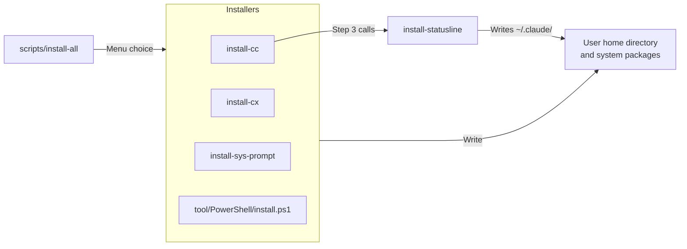

# cli-agents

- 本目錄整理各 AI CLI agent 的參考文件、使用者級別設定範本，以及寫入使用者家目錄的一鍵安裝腳本。

## Table of Contents

- [文件索引](#文件索引)
- [一鍵安裝腳本](#一鍵安裝腳本)
    - [共用 Prompt 安裝器行為](#共用-prompt-安裝器行為)
- [Agent 與 Skill 差異](#agent-與-skill-差異)
    - [核心區分](#核心區分)
    - [兩者如何搭配](#兩者如何搭配)
    - [Claude Code 與 GitHub Copilot 的差異](#claude-code-與-github-copilot-的差異)
    - [Marketplace / Plugin 能不能放 Agent](#marketplace--plugin-能不能放-agent)
    - [這個 repo 目前怎麼看](#這個-repo-目前怎麼看)

---

## 文件索引

| 文件                                                                                | 說明                                                                                                         |
|-------------------------------------------------------------------------------------|--------------------------------------------------------------------------------------------------------------|
| [common-prompt.md](common-prompt.md) / [common-prompt_zhTW.md](common-prompt_zhTW.md) | 可追加到 Claude Code、Codex 等 AI 工具設定檔的共用基本守則，包含語言偏好、工作態度與禁止行為                 |
| [hooks-cross-tool.md](hooks-cross-tool.md)                                          | 比較 Claude Code、GitHub Copilot CLI、Codex CLI 的 hook 核心差異，並整理共用 plugin skill + hook 的封裝策略  |
| [claude-code/cc-cli.md](claude-code/cc-cli.md)                                      | Claude Code：CLI 參數、slash commands、快捷鍵，以及 built-in / custom agent 用法                             |
| [github-copilot/gc-cli.md](github-copilot/gc-cli.md)                                | GitHub Copilot CLI：CLI 參數、slash commands、custom instructions，以及 built-in / custom agent 用法         |
| [codex/cx-cli.md](codex/cx-cli.md)                                                  | Codex CLI：安裝、登入、approval / sandbox、`codex exec`、subagents、`AGENTS.md`、slash commands、config，以及 TUI 快捷操作 |

- 各工具目錄下的 `.claude/`、`.codex/`、`.copilot/` 是使用者級別設定範本，複製到家目錄對應位置才會生效。

[Back to top](#table-of-contents)

---

## 一鍵安裝腳本



- 這些腳本會寫入**使用者家目錄**（repo 之外），因此不收錄在 [scripts/SCRIPTS.md](../scripts/SCRIPTS.md)。
- [scripts/install-all.ps1 / .sh](../scripts/SCRIPTS.md#install-all) 提供互動選單，可一次選擇要執行的安裝項目；桌面應用程式熱鍵腳本（`setup-cc-desktop-ahk.ps1`、`setup-cx-desktop-ahk.ps1`）放在 `scripts/` 下，收錄在 [scripts/SCRIPTS.md](../scripts/SCRIPTS.md)。
- `install-cc` 與 `install-cx` 會呼叫系統套件管理器（winget / Homebrew）安裝或更新 Node.js，並用 `npm install -g` 安裝或更新 CLI，屬於系統層級變更；其餘腳本只部署或修改使用者設定檔，各自的副作用見下表。

| 腳本                                                                  | 安裝目標                                                                                  | 內容                                                                                                                                                                                                                                                                                                                                                                                   | 範例                                                                                     |
|-----------------------------------------------------------------------|-------------------------------------------------------------------------------------------|----------------------------------------------------------------------------------------------------------------------------------------------------------------------------------------------------------------------------------------------------------------------------------------------------------------------------------------------------------------------------------------|------------------------------------------------------------------------------------------|
| [claude-code/install-cc.ps1](claude-code/install-cc.ps1)              | 系統層級（Node.js/npm）+ `$env:USERPROFILE\.claude\`                                      | 三步驟：1) 缺 npm 時用 winget 安裝 Node.js LTS；已有 npm 且是 winget 裝的（`winget list -e --id OpenJS.NodeJS.LTS` 找得到）才執行 `winget upgrade`，若 npm 是用其他方式裝的（如 nvm）則略過更新、直接沿用；2) `npm install -g @anthropic-ai/claude-code` 安裝/更新 Claude Code CLI；3) 呼叫同資料夾的 [install-statusline.ps1](claude-code/install-statusline.ps1) 部署 statusLine 與 hooks（此步驟用內建 `ConvertFrom-Json`/`ConvertTo-Json`，不需要 `jq`） | `powershell -ExecutionPolicy Bypass -File .\cli-agents\claude-code\install-cc.ps1`       |
| [claude-code/install-cc.sh](claude-code/install-cc.sh)                | 系統層級（Node.js/npm/jq）+ `~/.claude/`                                                  | macOS 版對應腳本，同樣三步驟，改用 Homebrew：缺 npm 時 `brew install node`；已有 npm 且是 Homebrew 裝的（`brew list node` 找得到）才 `brew upgrade node`，否則略過更新；第三步前先確保 `jq` 存在（缺的話用 `brew install jq` 補上），再呼叫 [install-statusline.sh](claude-code/install-statusline.sh)                                                                                | `bash ./cli-agents/claude-code/install-cc.sh`                                            |
| [claude-code/install-statusline.ps1](claude-code/install-statusline.ps1) | `~/.claude/`                                                                           | 複製 [statusline-command.sh](claude-code/statusline-command.sh) 與 [hooks/*.sh](claude-code/hooks/)；在 `~/.claude/settings.json` 注入 `statusLine`，以及 `UserPromptSubmit` / `PreToolUse` / `Stop` 三個即時狀態追蹤 hooks                                                                                                                                                         | `powershell -ExecutionPolicy Bypass -File .\cli-agents\claude-code\install-statusline.ps1` |
| [claude-code/install-statusline.sh](claude-code/install-statusline.sh) | `~/.claude/`                                                                             | `install-statusline.ps1` 的 macOS/Linux 版本，邏輯相同；用 `jq` 安全改寫 `settings.json`（需先自行安裝，例如 `brew install jq`），未安裝時會直接報錯並提示                                                                                                                                                                                                                          | `bash ./cli-agents/claude-code/install-statusline.sh`                                    |
| [codex/install-cx.ps1](codex/install-cx.ps1)                          | 系統層級（Node.js/npm）+ `$env:USERPROFILE\.codex\pets\`                                  | 三步驟：1) 與 `install-cc.ps1` 相同的 npm 檢查/安裝/更新邏輯（winget，只在 `winget list` 找得到時才 upgrade）；2) `npm install -g @openai/codex` 安裝/更新 Codex CLI；3) 把同資料夾的 [pets/](codex/pets/) 遞迴複製到 `~/.codex/pets/`（覆蓋同名檔案，不刪除目的地多出來的檔案）                                                                                               | `powershell -ExecutionPolicy Bypass -File .\cli-agents\codex\install-cx.ps1`             |
| [codex/install-cx.sh](codex/install-cx.sh)                            | 系統層級（Node.js/npm）+ `~/.codex/pets/`                                                 | macOS 版對應腳本，同樣三步驟，改用 Homebrew 處理 npm（邏輯與 `install-cc.sh` 相同），第三步用 `cp -Rf` 把 [pets/](codex/pets/) 複製到 `~/.codex/pets/`                                                                                                                                                                                                                              | `bash ./cli-agents/codex/install-cx.sh`                                                  |
| [install-sys-prompt.ps1](install-sys-prompt.ps1)                      | `$env:USERPROFILE\.claude\`、`$env:USERPROFILE\.codex\`、`$env:USERPROFILE\.copilot\`     | 若目標檔已存在，先改名備份為 `<檔名>_yyMMddHHmmss`，再複製三個工具的提示範本；然後將 [common-prompt.md](common-prompt.md) append 到 `CLAUDE.md`、`AGENTS.md` 與 `copilot-instructions.md` 底部                                                                                                                                                                                       | `powershell -ExecutionPolicy Bypass -File .\cli-agents\install-sys-prompt.ps1`           |
| [install-sys-prompt.sh](install-sys-prompt.sh)                        | `$HOME/.claude/`、`$HOME/.codex/`、`$HOME/.copilot/`                                      | 與 PowerShell 版本相同，適用於 POSIX shell、macOS、Linux 與 Git Bash；先部署範本，再將 [common-prompt.md](common-prompt.md) append 到 `CLAUDE.md`、`AGENTS.md` 與 `copilot-instructions.md` 底部                                                                                                                                                                                      | `bash ./cli-agents/install-sys-prompt.sh`                                                |
| [tool/PowerShell/install.ps1](../tool/PowerShell/install.ps1)         | Documents 下的 `PowerShell\`（profile）+ `$HOME\.config\powershell\`（其餘腳本）          | 複製 [Microsoft.PowerShell_profile.ps1](../tool/PowerShell/Microsoft.PowerShell_profile.ps1) 到 pwsh profile 資料夾；其餘 `tool/PowerShell/` 下的腳本（`local_profile.ps1`、`Exe-*.ps1`、`Set-*.ps1` 等）複製到 `.config\powershell\`；詳見 [tool/TOOL.md](../tool/TOOL.md)                                                                                                      | `powershell -ExecutionPolicy Bypass -File .\tool\PowerShell\install.ps1`                 |

### 共用 Prompt 安裝器行為

- 以下行為同時適用於 [install-sys-prompt.ps1](install-sys-prompt.ps1) 與 [install-sys-prompt.sh](install-sys-prompt.sh)。
- 可重複執行；每次會先將既有目標檔改名備份為 `<檔名>_yyMMddHHmmss`，同一次執行的三個檔案共用同一個時間戳記。
- 備份不會自動清除，長期重複執行會在同目錄下累積多個備份檔，需要時自行手動清理。
- 若來源檔案不存在或複製失敗，腳本會停止並回傳錯誤，且在檢查完成前不建立、不改名、不覆寫任何目標檔。

| 前置狀態                                                                    | 執行       | 預期結果                                                                                                                                                                   |
|-----------------------------------------------------------------------------|------------|----------------------------------------------------------------------------------------------------------------------------------------------------------------------------|
| 三個目標目錄不存在，來源範本與 [common-prompt.md](common-prompt.md) 都存在   | 執行安裝器 | 建立 `.claude`、`.codex`、`.copilot`；`CLAUDE.md`、`AGENTS.md`、`copilot-instructions.md` 都由各自範本加上 [common-prompt.md](common-prompt.md) 組成；不產生任何備份檔   |
| `CLAUDE.md` 已存在且內容為自訂文字                                          | 再次執行   | 先把現有 `CLAUDE.md` 改名為 `CLAUDE.md_yyMMddHHmmss`（原自訂文字完整保留在備份檔中），再以 Claude 範本重新產生 `CLAUDE.md` 並將 [common-prompt.md](common-prompt.md) append 到底部 |
| 任一來源範本或 [common-prompt.md](common-prompt.md) 不存在                  | 執行安裝器 | 顯示來源檔案錯誤、回傳非零狀態，且在檢查完成前不建立、不改名、不覆寫任何目標檔                                                                                             |

- PowerShell 範例：

```powershell
powershell -ExecutionPolicy Bypass -File .\cli-agents\install-sys-prompt.ps1
```

- 首次執行（目標檔皆不存在）的成功輸出會列出三個 `Template` 與三個 `Common prompt` `[OK]` 項目，最後顯示 `Done.`；重複執行時，每個目標檔前面會多一行 `[Backup] <原檔> -> <原檔>_yyMMddHHmmss`。shell 版本的成功輸出語意相同。

[Back to top](#table-of-contents)

---

## Agent 與 Skill 差異

- 這一節整理對 **Claude Code** 與 **GitHub Copilot CLI** 的 agent / skill 研究結論；各工具的 CLI 與 agent 使用方式以本目錄下的文件為準。

### 核心區分

- **一句話：`agent` 是「誰來做」；`skill` 是「怎麼做」。**

| 面向           | Agent                                            | Skill                                                         |
|----------------|--------------------------------------------------|---------------------------------------------------------------|
| 本質           | 專家角色 / 執行者                                | SOP / 任務知識包                                              |
| 系統實際做的事 | 啟動一個專門 agent 或 subagent 去做              | 把對應的 `SKILL.md` 與附帶資源注入目前 agent 的 context       |
| Context        | 常有獨立 context，適合隔離探索、測試、review     | 多半沿用目前對話 context，屬 just-in-time 指南                |
| 主要關注       | 角色、工具權限、模型、隔離、背景執行、可否委派   | 步驟、模板、範例、腳本、輸出格式                              |
| 適合場景       | `security-auditor`、`code-reviewer`、`test-runner` | `skills-governance`、release note / deploy SOP              |

### 兩者如何搭配

| 層次                | 用途                                                         |
|---------------------|--------------------------------------------------------------|
| custom instructions | 所有任務都應遵守的 repo 慣例與溝通方式                       |
| skill               | 某一類任務才需要的知識、步驟與模板                           |
| agent               | 負責執行任務的角色與 runtime 邊界                            |
| tool / MCP          | 實際能力來源，例如讀檔、改檔、查 GitHub、操作外部服務        |

- 實務上比較穩的設計：**把知識與流程放 skill，把角色、權限與執行邊界放 agent**。
- 例如本 repo 的 [.claude/skills](../.claude/skills/) 收的就是 repo 專用 skills，不是 agents。

### Claude Code 與 GitHub Copilot 的差異

| 項目                   | Claude Code                                                                                       | GitHub Copilot CLI                                                                              |
|------------------------|---------------------------------------------------------------------------------------------------|-------------------------------------------------------------------------------------------------|
| Agent 定位             | 比較像可編排的 subagent runtime                                                                   | 比較像 specialist persona + tool profile                                                        |
| Skill 定位             | skills 除知識外，還能設定 `allowed-tools`、`context: fork`、`hooks` 等行為                        | skills 是 task-specific instructions，可附 scripts / resources，偏 just-in-time workflow        |
| Agent 與 Skill 搭配    | custom agent 可透過 `skills` 欄位預載 skills 內容                                                 | custom agent 與 skills 都能共存，但 custom agent 主要負責角色與工具邊界                         |
| Agent 裡能否再叫 Agent | 被派出去的 subagent 不能再 spawn subagent；若整個 session 以 `claude --agent` 啟動，主執行緒仍可再派 | custom agent `tools` 支援 `agent` alias，可再叫其他 custom agent，但不建議做太深巢狀            |

### Marketplace / Plugin 能不能放 Agent

- 可以，但精準說法是：**marketplace 是分發 plugin 的地方；真正承載 agent 的是 plugin。**

| 平台               | marketplace / plugin 能否包含 agent | 典型位置                                  | 補充                                                     |
|--------------------|-------------------------------------|-------------------------------------------|----------------------------------------------------------|
| Claude Code        | 可以                                | plugin root 的 `agents/`                  | plugin 可包含 `skills`、`agents`、`hooks`、`MCP`、`LSP`  |
| GitHub Copilot CLI | 可以                                | plugin root 的 `agents/`，檔名 `*.agent.md` | plugin 可包含 `agents`、`skills`、`hooks`、`MCP` 等元件 |

- agent 不像 skill 那樣容易跨 Claude Code / Copilot CLI 共用同一份定義；兩邊都能透過 plugin / marketplace 發佈 agent，但 frontmatter、檔名格式、可用欄位與 tool naming 都不同：
    1. **Claude Code plugin agents** 支援 `skills`、`memory`、`background`、`isolation` 等欄位，但 plugin-shipped agents 不支援 `hooks`、`mcpServers`、`permissionMode`。
    2. **GitHub Copilot CLI plugin agents** 使用 `.agent.md` 格式，欄位與 tool aliases 也和 Claude Code 不同。
    3. 要讓同一個 marketplace root 同時服務兩邊，可以共用同一個 plugin root 概念，但 agent 通常仍要各自包 wrapper；skill 才比較適合共用同一套內容。

### 這個 repo 目前怎麼看

1. [.claude/skills](../.claude/skills/) 是本 repo 的 **project skill 生態**，只放本 repo 執行維護任務時需要的 workflow。
2. 本目錄整理各工具的 CLI、agent 建立、使用與能力邊界。
3. 若未來要新增可分發的 plugin / marketplace，兩邊都做得到，但不應假設一份 agent 定義可直接跨兩邊共用。
4. 設計新能力時猶豫該做 agent 還是 skill，先問：**我要的是專家，還是手冊？** 要專家就做 agent；要手冊就做 skill。

[Back to top](#table-of-contents)
