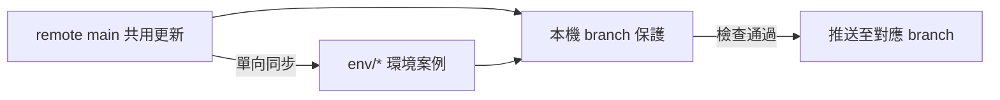

# 本機 branch 保護

## Table of Contents

- [流程](#流程)
- [模組](#模組)

## 流程

- 每個 clone 啟用本機 hooks，Git 在提交與推送前依 branch 規範驗證；違規操作停止，由使用者決定處理方式。

[Back to top](#table-of-contents)

---

## 模組

- [Git branch guard](../scripts/sd-git-branch-guard.md) 負責本機安裝入口、Git hooks 與操作檢查，並明訂本機防護的限制。

[Back to top](#table-of-contents)
