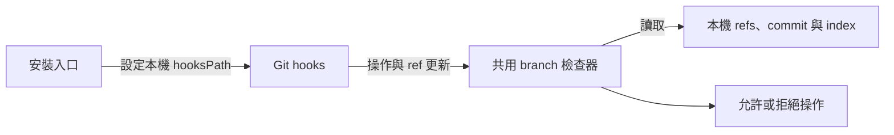

# Git branch guard

## Table of Contents

- [責任與邊界](#責任與邊界)
- [介面](#介面)
- [限制](#限制)

## 責任與邊界

- 本機 Git hooks 檢查 main 開發、環境紀錄與 main 單向同步；拒絕操作時保留狀態，由使用者決定後續處理。

[Back to top](#table-of-contents)

---

## 介面

- [安裝入口](install-git-hooks.mjs) 設定本 clone 的 hooksPath，保留既有自訂 hook 設定。
- [Git hook 入口](../.githooks/) 共用 [branch 檢查器](git-branch-guard.mjs)；[隔離測試](tests/test_git_branch_guard.py) 定義具體驗收情境。
- 使用者操作與部署方式見 [Scripts 說明](SCRIPTS.md#git-branch-hooks)；上層流程見 [branch 保護](../docs/bd-branch-protection.md)。

[Back to top](#table-of-contents)

---

## 限制

- Git 2.24 以上與 Node.js 18 以上必須可從 Git 呼叫的 shell PATH 執行；每個 clone 必須另行啟用 hooks。
- 僅支援名為 origin 的 remote。分支建立與更新只允許 main 或 env/*；分支刪除、非 fast-forward 更新、detached HEAD 與 orphan 提交拒絕；tag 與其他非 head refs 不受分支規則限制。
- 非 fast-forward 同步使用 merge --no-commit，再以 commit 驗證 MERGE_HEAD。自動 merge 提早拒絕；白名單檔案的衝突由使用者決定處理，不自動解決。submodule checkout 漂移及子 repo 的已修改或未追蹤內容也會阻擋提交，先查狀態再由使用者處理，不自動清理。
- pre-push 檢查提交歷史及實際目標 refs，不以乾淨工作區或最終 diff 代替逐筆驗證。main 的來源判定依已知 env refs；共享未發布歷史有歧義時保守拒絕。
- hooks 依本機 fetch 後的 origin/main 判斷；不在 hook 內連網。refs 可能過期，紀錄流程仍必須先 fetch；背景 fetch 改變同步 tip 時必須重新確認。
- hooks 可停用或略過，不涵蓋 GitHub 網頁、PR 或 API 操作，也不能可靠辨識任意複製、squash 或 cherry-pick 的語意來源。
- 本模組不負責新增案例、自動 commit/push 或安裝提示詞；它檢查這些 Git 操作是否符合規範。

[Back to top](#table-of-contents)
