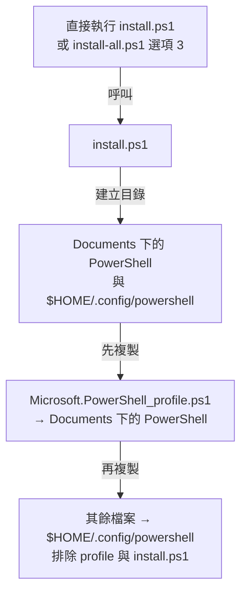
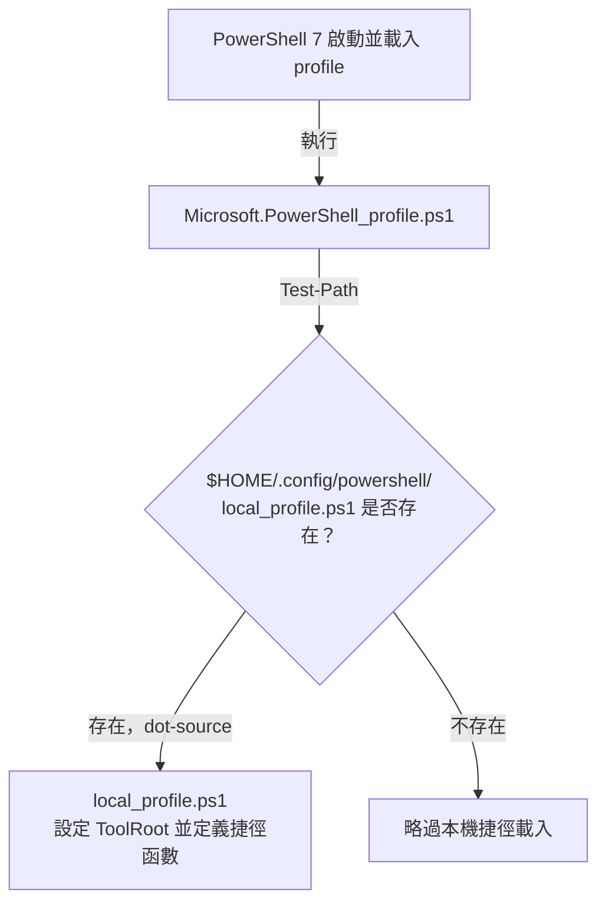
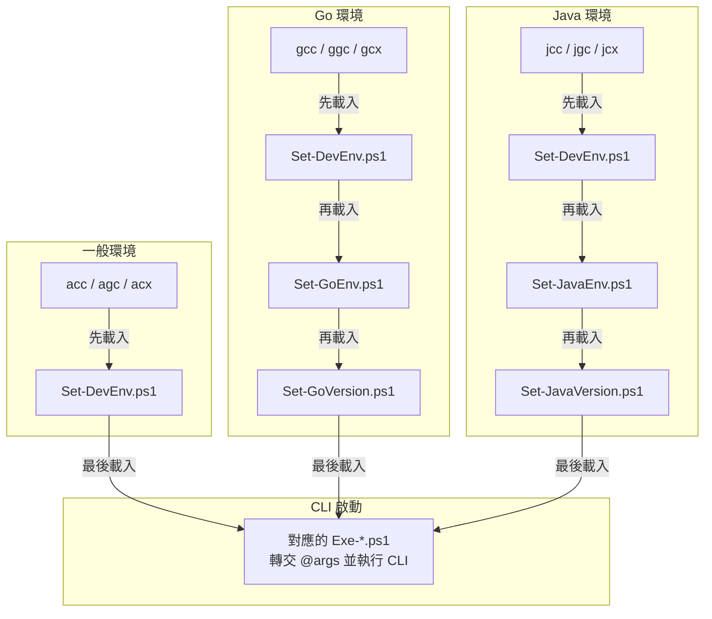

# PowerShell 腳本呼叫流程

- 本目錄提供 profile、工作目錄捷徑與 AI CLI 啟動腳本；安裝流程只複製檔案，Go、Java、Maven 與各 CLI 須另行安裝。

## Table of Contents

- [安裝與部署](#安裝與部署)
- [啟動與載入](#啟動與載入)
- [檔案清單捷徑](#檔案清單捷徑)
- [AI CLI 呼叫順序](#ai-cli-呼叫順序)
- [工作目錄捷徑](#工作目錄捷徑)

## 安裝與部署

- 入口：[install.ps1](install.ps1)；整合選單：[install-all.ps1](../../scripts/install-all.ps1)。
- Documents 路徑透過 `[Environment]::GetFolderPath([Environment+SpecialFolder]::MyDocuments)` 取得；目的地固定使用 PowerShell 7 的 `PowerShell` 子目錄，即使從 Windows PowerShell 5.1 執行安裝也相同。
- 其餘檔案包含 [local_profile.ps1](local_profile.ps1)、`Exe-*.ps1`、`Set-*.ps1` 與本文件；僅處理本層檔案，不遞迴子目錄。
- 同名檔案直接覆蓋，不備份；目的地多出的檔案不會被刪除。

[回到目錄](#table-of-contents)

---

## 啟動與載入

- [Microsoft.PowerShell_profile.ps1](Microsoft.PowerShell_profile.ps1) 以 dot-source（`. 腳本路徑`）載入 [local_profile.ps1](local_profile.ps1)，讓函數可在目前工作階段使用。
- `ToolRoot` 固定為 `$HOME/.config/powershell`，後續捷徑均從此處載入腳本。
- 載入 profile 只定義捷徑；使用者呼叫 AI CLI 捷徑時，才設定開發環境並啟動 CLI。
- 使用 `pwsh -NoProfile` 時不會自動執行此流程。

[回到目錄](#table-of-contents)

---

## 檔案清單捷徑

- [local_profile.ps1](local_profile.ps1) 提供 `ll`，執行 `Get-ChildItem -Force`，在終端顯示包含隱藏項目的詳細清單；欄位採 PowerShell 預設格式。
- 參數沿用 `Get-ChildItem`，不使用 Linux `ls` 的 `-l`、`-a` 等參數；輸出保留原始物件，可接續管線處理。

| 指令 | 用途 |
|---|---|
| `ll` | 列出目前目錄，包含隱藏檔案與目錄。 |
| `ll 'C:\Program Files'` | 列出指定目錄，支援含空白的路徑。 |
| `ll -File` | 只列出檔案，包含隱藏檔。 |
| `ll -Directory` | 只列出目錄，包含隱藏目錄。 |
| `ll *.ps1` | 使用萬用字元篩選檔案。 |
| `ll -File \| Sort-Object Length -Descending` | 依檔案大小由大到小排序。 |

- 更新後執行 [install.ps1](install.ps1) 部署，再開啟新的 PowerShell 7；目前工作階段可執行 `. $PROFILE` 重新載入。

[回到目錄](#table-of-contents)

---

## AI CLI 呼叫順序

| CLI | 一般環境 | Go 環境 | Java 環境 | 最後執行的腳本與命令 |
|---|---|---|---|---|
| Claude Code | `acc` | `gcc` | `jcc` | [Exe-CC.ps1](Exe-CC.ps1)：`claude --permission-mode bypassPermissions @args` |
| GitHub Copilot | `agc` | `ggc` | `jgc` | [Exe-GC.ps1](Exe-GC.ps1)：`copilot --allow-all-tools @args` |
| Codex | `acx` | `gcx` | `jcx` | [Exe-CX.ps1](Exe-CX.ps1)：`codex --sandbox danger-full-access -a never @args` |

| 環境設定腳本 | 設定內容 |
|---|---|
| [Set-DevEnv.ps1](Set-DevEnv.ps1) | 共用開發環境變數；目前設定 `AERY_TEST`。 |
| [Set-GoEnv.ps1](Set-GoEnv.ps1) | `GO_BIN_HOME` 指向 `$HOME/go/bin`，必要時加到 `PATH` 前端。 |
| [Set-GoVersion.ps1](Set-GoVersion.ps1) | `GO_HOME` 指向指定 Go 版本的 `bin`，必要時加到 `PATH` 前端。 |
| [Set-JavaEnv.ps1](Set-JavaEnv.ps1) | `MAVEN_HOME` 指向指定 Maven 安裝目錄，必要時將其 `bin` 加到 `PATH` 前端。 |
| [Set-JavaVersion.ps1](Set-JavaVersion.ps1) | `JAVA_HOME` 指向指定 JDK 安裝目錄，必要時將其 `bin` 加到 `PATH` 前端。 |

- 例如 `jcx --resume`：依序 dot-source [Set-DevEnv.ps1](Set-DevEnv.ps1) → [Set-JavaEnv.ps1](Set-JavaEnv.ps1) → [Set-JavaVersion.ps1](Set-JavaVersion.ps1) → [Exe-CX.ps1](Exe-CX.ps1)，最後執行 `codex --sandbox danger-full-access -a never --resume`。
- 環境腳本都透過 dot-source 載入；設定的環境變數會留在目前 PowerShell 工作階段，CLI 結束後不會自動還原。
- AI CLI 捷徑不切換工作目錄；CLI 使用呼叫當下的目錄。

[回到目錄](#table-of-contents)

---

## 工作目錄捷徑

- 下列函數定義於 [local_profile.ps1](local_profile.ps1)，只切換目前目錄，不載入環境腳本或啟動 CLI。

| 函數 | 切換目的地 |
|---|---|
| `aws` | `$HOME/AeryProjects` |
| `gws` | `$HOME/GolangProjects` |
| `jws` | `$HOME/JavaProjects` |

[回到目錄](#table-of-contents)

---
