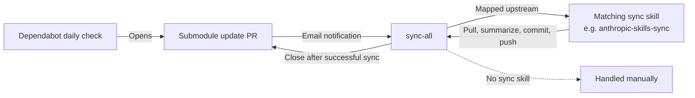

# upstream

- 本目錄以 git submodule 追蹤上游專案（skill、plugin、MCP server 等）。
- 本 repo 嚴禁直接修改 submodule 內容；要確認某個 upstream skill 的用途，直接讀它在 submodule 內的原始 `SKILL.md`，例如 [anthropic-skills/skills](anthropic-skills/skills/)，實際使用時則用已安裝的版本。

## Table of Contents

- [上游清單](#上游清單)
- [同步上游更新](#同步上游更新)
- [.claude-plugin 檔案說明](#claude-plugin-檔案說明)
- [anthropic-skills](#anthropic-skills)
- [webwright](#webwright)
- [codex-plugin-cc](#codex-plugin-cc)
- [playwright-mcp](#playwright-mcp)

---

## 上游清單

| 目錄                                    | 類型               | 來源                                                     | 用途                                                                           |
|-----------------------------------------|--------------------|----------------------------------------------------------|--------------------------------------------------------------------------------|
| [anthropic-skills](anthropic-skills)     | skill              | [anthropics/skills](https://github.com/anthropics/skills)             | 創意設計、前端工程、AI 工程、Office 文件、技術寫作                             |
| [webwright](webwright)                   | skill              | [microsoft/Webwright](https://github.com/microsoft/Webwright)         | 瀏覽器自動化：以單一 bash command 驅動本地 Playwright workspace，附截圖與 action log 自我驗證 |
| [codex-plugin-cc](codex-plugin-cc)       | Claude Code plugin | [openai/codex-plugin-cc](https://github.com/openai/codex-plugin-cc)   | 在 Claude Code 內呼叫 Codex 做 code review 或委派任務                          |
| [playwright-mcp](playwright-mcp)         | MCP server         | [microsoft/playwright-mcp](https://github.com/microsoft/playwright-mcp) | 瀏覽器自動化：以 Playwright accessibility snapshot 操作網頁                    |

[Back to top](#table-of-contents)

---

## 同步上游更新



- [Dependabot](../.github/dependabot.yml) 每日偵測所有 submodule 的上游變更並開 PR；收到通知後 invoke `sync-all` 同步。
- `sync-all` 只處理 [對應表](../.claude/skills/sync-all/SKILL.md) 內有 sync skill 的上游，目前只有 `anthropic-skills`。
- `webwright`、`codex-plugin-cc`、`playwright-mcp` 沒有對應 sync skill，`sync-all` 會跳過，需要另外處理。
- 各 sync skill 共用的流程協議在 [upstream-sync-protocol.md](../.claude/skills/_shared/upstream-sync-protocol.md)；新增 sync skill 時只需引用它並填入該庫的設定。

[Back to top](#table-of-contents)

---

## .claude-plugin 檔案說明

- Claude Code plugin 系統在 `.claude-plugin/` 目錄下有兩種設定檔，職責不同：

| 檔案               | 層次           | 定義的是什麼                                               |
|--------------------|----------------|------------------------------------------------------------|
| `marketplace.json` | Marketplace 層 | 一個目錄清單：列出要發行哪些 plugins、各自來源與設定       |
| `plugin.json`      | Plugin 層      | 單個 plugin 的身份：`name`, `version`, `author`, `keywords`… |

- `anthropic-skills` 只有 `marketplace.json`，因為它純粹是一個 marketplace，打包了 `document-skills`、`example-skills`、`claude-api` 等多個 plugin。
- 它的 `marketplace.json` 對每個 plugin 都設了 `"strict": false`：
    - `strict: false`：marketplace entry 是完整定義，plugin 內不需要自備 `plugin.json`。
    - 預設 `strict: true`：plugin 自己的 `plugin.json` 才是權威來源。

[Back to top](#table-of-contents)

---

## anthropic-skills

- 主要透過 Claude Code / GitHub Copilot CLI 的 plugin marketplace 使用；本 repo 尚未替它提供 Codex marketplace 或 `.codex-plugin` 封裝。
- 詳細設定見 [anthropic-skills/.claude-plugin/marketplace.json](anthropic-skills/.claude-plugin/marketplace.json)。

| 維度 | Claude Code                                                                                                                                                                                                      | GitHub Copilot CLI                                                                                                                                                                                                                    | Codex                                                                                                                         |
|------|------------------------------------------------------------------------------------------------------------------------------------------------------------------------------------------------------------------|---------------------------------------------------------------------------------------------------------------------------------------------------------------------------------------------------------------------------------------|-------------------------------------------------------------------------------------------------------------------------------|
| 說明 | 使用 `anthropics/skills` 作為 marketplace source，marketplace 名稱是 `anthropic-agent-skills`。                                                                                                                  | 使用同一份 `.claude-plugin/marketplace.json`，透過 `copilot plugin` 註冊 marketplace 並安裝 plugin。                                                                                                                                  | 目前不適用；`upstream/anthropic-skills/` 沒有 Codex 用的 `.agents/plugins/marketplace.json` 或 `.codex-plugin/plugin.json`。 |
| 安裝 | `/plugin marketplace add anthropics/skills`<br>`/plugin install document-skills@anthropic-agent-skills`<br>`/plugin install example-skills@anthropic-agent-skills`<br>`/plugin install claude-api@anthropic-agent-skills`<br>`/reload-plugins` | `copilot plugin marketplace add anthropics/skills`<br>`copilot plugin install document-skills@anthropic-agent-skills`<br>`copilot plugin install example-skills@anthropic-agent-skills`<br>`copilot plugin install claude-api@anthropic-agent-skills`<br>`copilot plugin list` | 需先另建 Codex 封裝後才能安裝。                                                                                               |
| 更新 | `/plugin marketplace update anthropic-agent-skills`<br>`/reload-plugins`<br>或在 `/plugin` 的 Marketplaces tab 對 `anthropic-agent-skills` 啟用 auto-update。                                                     | `copilot plugin update document-skills@anthropic-agent-skills`<br>`copilot plugin update example-skills@anthropic-agent-skills`<br>`copilot plugin update claude-api@anthropic-agent-skills`                                          | 不適用。                                                                                                                      |
| 移除 | `/plugin uninstall document-skills@anthropic-agent-skills`<br>`/plugin uninstall example-skills@anthropic-agent-skills`<br>`/plugin uninstall claude-api@anthropic-agent-skills`<br>`/plugin marketplace remove anthropic-agent-skills` | `copilot plugin uninstall document-skills@anthropic-agent-skills`<br>`copilot plugin uninstall example-skills@anthropic-agent-skills`<br>`copilot plugin uninstall claude-api@anthropic-agent-skills`<br>`copilot plugin marketplace remove anthropic-agent-skills` | 不適用。                                                                                                                      |

- **已知 bug**：若同一批 skills 同時由 project top-level entries 與 plugin namespace 暴露，context 與 slash command picker 仍可能重複；目前的結構就是為了避免這個情況。相關 issue：[anthropics/claude-code#29520](https://github.com/anthropics/claude-code/issues/29520)、[anthropics/skills#189](https://github.com/anthropics/skills/issues/189)。

[Back to top](#table-of-contents)

---

## webwright

- Microsoft Research 出品的瀏覽器代理 skill：把宿主 agent 變成 browser agent，一次一個 bash command 驅動本地 Playwright workspace。
- 每步截圖與 action log 保存在 `final_runs/run_<id>/`，再以視覺方式自我驗證結果。
- 上游同時提供 Claude Code 與 Codex 的 plugin manifest，[webwright/skills/webwright](webwright/skills/webwright/) 的內容兩端共用。
- 詳細設定見 [webwright/.claude-plugin/marketplace.json](webwright/.claude-plugin/marketplace.json)、[webwright/.claude-plugin/plugin.json](webwright/.claude-plugin/plugin.json) 與 [webwright/.codex-plugin/plugin.json](webwright/.codex-plugin/plugin.json)。

| 維度 | Claude Code                                                                                         | GitHub Copilot CLI                                                                                            | Codex                                                                                                                                                                       |
|------|-----------------------------------------------------------------------------------------------------|---------------------------------------------------------------------------------------------------------------|-----------------------------------------------------------------------------------------------------------------------------------------------------------------------------|
| 說明 | Marketplace source 是 `microsoft/Webwright`，marketplace 與 plugin 名稱皆為 `webwright`。          | Copilot CLI 讀取相同 Claude 風格 marketplace，透過 `copilot plugin` 註冊與安裝。                              | 優先用 Codex 的 user-level skill discovery，把 Webwright skill junction 到 `~/.agents/skills/webwright`。                                                                   |
| 安裝 | `/plugin marketplace add microsoft/Webwright`<br>`/plugin install webwright@webwright`<br>`/reload-plugins` | `copilot plugin marketplace add microsoft/Webwright`<br>`copilot plugin install webwright@webwright`<br>`copilot plugin list` | 建立 `~/.agents/skills/webwright` junction，並安裝 Webwright runtime；完整 PowerShell 流程見下方。                                                                          |
| 更新 | `/plugin marketplace update webwright`<br>`/reload-plugins`                                         | `copilot plugin update webwright@webwright`                                                                   | 更新 submodule 後重新開 Codex；junction 會指向新的 submodule 內容。若 submodule 路徑變更，重新執行下方流程，它會重建 junction 並重新安裝 editable runtime。                 |
| 移除 | `/plugin uninstall webwright@webwright`<br>`/plugin marketplace remove webwright`                   | `copilot plugin uninstall webwright@webwright`<br>`copilot plugin marketplace remove webwright`               | 刪除 `~/.agents/skills/webwright` junction；可選擇保留或移除 Python runtime。                                                                                               |

- Codex 建議使用下列 skill-only 安裝流程，在 repo 根目錄執行：

```powershell
git submodule update --init --recursive

$skillTarget = Resolve-Path "upstream\webwright\skills\webwright"
$skillLink = Join-Path $env:USERPROFILE ".agents\skills\webwright"
New-Item -ItemType Directory -Force -Path (Split-Path $skillLink) | Out-Null
$existing = Get-Item -LiteralPath $skillLink -Force -ErrorAction SilentlyContinue
if ($existing -and $existing.LinkType -eq 'Junction') {
    cmd /c rmdir "$skillLink"
    $existing = $null
}
if (-not $existing) {
    New-Item -ItemType Junction -Path $skillLink -Target $skillTarget.Path | Out-Null
}

python -m pip install -e "upstream\webwright"
python -m playwright install firefox
```

- 安裝後用這些指令確認狀態：

```text
codex
/skills
```

```powershell
python -m playwright --version
```

- 重新開 Codex 後，可用 `$webwright` 明確呼叫，或讓 Codex 依 [webwright/skills/webwright/SKILL.md](webwright/skills/webwright/SKILL.md) 的 description 自動觸發。
- 若要使用原生 Webwright CLI harness，再額外執行 `python -m playwright install chromium` 並依 backend 設定 API key；`python -m webwright.run.cli doctor` 檢查的是原生 harness，不是 Codex skill-only 路徑。
- [Webwright 官方 README](https://github.com/microsoft/Webwright) 仍列出 `codex plugin marketplace add microsoft/Webwright` → `/plugins` 的 plugin 安裝流程；但 [microsoft/Webwright issue #37](https://github.com/microsoft/Webwright/issues/37) 回報該 Git marketplace 缺少 Codex 會列舉的 `.agents/plugins/marketplace.json` index，導致 `webwright` 在 Codex plugin browser 內不可見。等上游補齊 marketplace index 後，再改回官方 plugin 流程。

[Back to top](#table-of-contents)

---

## codex-plugin-cc

- OpenAI 出品的 Claude Code plugin：在 Claude Code 內呼叫 Codex 做 code review（`/codex:review`、`/codex:adversarial-review`）或委派任務（`/codex:rescue`、`/codex:transfer`），並以 `/codex:status`、`/codex:result`、`/codex:cancel` 管理背景工作。
- 上游只提供 Claude Code 用的 `.claude-plugin` manifest。
- 使用前需要 Node.js 18.18 以上，以及 ChatGPT 訂閱或 OpenAI API key。
- 詳細設定見 [codex-plugin-cc/.claude-plugin/marketplace.json](codex-plugin-cc/.claude-plugin/marketplace.json) 與 [codex-plugin-cc/plugins/codex/.claude-plugin/plugin.json](codex-plugin-cc/plugins/codex/.claude-plugin/plugin.json)。

| 維度 | Claude Code                                                                                                         |
|------|---------------------------------------------------------------------------------------------------------------------|
| 說明 | Marketplace source 是 `openai/codex-plugin-cc`，marketplace 名稱是 `openai-codex`，plugin 名稱是 `codex`。         |
| 安裝 | `/plugin marketplace add openai/codex-plugin-cc`<br>`/plugin install codex@openai-codex`<br>`/reload-plugins`<br>`/codex:setup` |
| 更新 | `/plugin marketplace update openai-codex`<br>`/reload-plugins`                                                      |
| 移除 | `/plugin uninstall codex@openai-codex`<br>`/plugin marketplace remove openai-codex`                                 |

[Back to top](#table-of-contents)

---

## playwright-mcp

- Microsoft 出品的 MCP server（npm 套件 `@playwright/mcp`）：透過 Playwright 的 accessibility snapshot 讓 LLM 操作網頁，不需要截圖或視覺模型。
- 上游沒有 plugin manifest，也沒有對外使用的 skill；`.claude/skills/release.md` 是上游內部的發版維護 skill。
- Claude Code 官方 marketplace 的 `playwright` plugin 只含 `plugin.json` 與 `.mcp.json`，以 `npx @playwright/mcp@latest` 啟動此 MCP server，見 [anthropics/claude-plugins-official/external_plugins/playwright](https://github.com/anthropics/claude-plugins-official/tree/main/external_plugins/playwright)。
- 使用前需要 Node.js 18 以上。
- 完整 client 設定與參數見 [playwright-mcp/README.md](playwright-mcp/README.md)；上游 README 也指出 coding agent 可改用 token 消耗較低的 [Playwright CLI + SKILLS](https://github.com/microsoft/playwright-cli)。

| 維度 | Claude Code                                                                                                                            | GitHub Copilot CLI                                                  | Codex                                                                                       |
|------|----------------------------------------------------------------------------------------------------------------------------------------|---------------------------------------------------------------------|---------------------------------------------------------------------------------------------|
| 說明 | 可安裝官方 marketplace 的 `playwright` plugin，或直接以 `claude mcp add` 註冊 MCP server。                                            | 以 `/mcp add` 互動式註冊，或編輯 `~/.copilot/mcp-config.json`。     | 以 `codex mcp add` 註冊，或編輯 `~/.codex/config.toml` 的 `[mcp_servers.playwright]`。      |
| 安裝 | `/plugin install playwright@claude-plugins-official`<br>`/reload-plugins`<br>或：<br>`claude mcp add playwright npx @playwright/mcp@latest` | `/mcp add`                                                          | `codex mcp add playwright npx "@playwright/mcp@latest"`                                     |
| 更新 | 設定使用 `@playwright/mcp@latest`，由 `npx` 在啟動 MCP server 時解析版本。                                                           | 同左。                                                              | 同左。                                                                                      |
| 移除 | `/plugin uninstall playwright@claude-plugins-official`<br>或：<br>`claude mcp remove playwright`                                       | 從 `~/.copilot/mcp-config.json` 刪除 `playwright` 項目。            | `codex mcp remove playwright`                                                               |

[Back to top](#table-of-contents)
